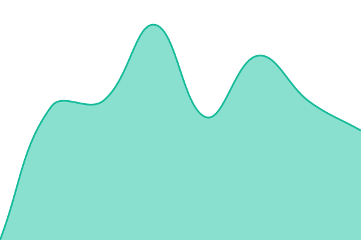

# [📈 Live Status](https://status2.concordia.gob.ar): <!--live status--> **🟩 All systems operational**

This repository contains the open-source uptime monitor and status page for [InfraIT-Concordia](https://status2.concordia.gob.ar), powered by [Upptime](https://github.com/upptime/upptime).

With [Upptime](https://upptime.js.org), you can get your own unlimited and free uptime monitor and status page, powered entirely by a GitHub repository. We use [Issues](https://github.com/InfraIT-Concordia/Servicios-Web/issues) as incident reports, [Actions](https://github.com/InfraIT-Concordia/Servicios-Web/actions) as uptime monitors, and [Pages](https://status2.concordia.gob.ar) for the status page.

<!--start: status pages-->
<!-- This summary is generated by Upptime (https://github.com/upptime/upptime) -->
<!-- Do not edit this manually, your changes will be overwritten -->
<!-- prettier-ignore -->
| URL | Status | History | Response Time | Uptime |
| --- | ------ | ------- | ------------- | ------ |
|  [Portal Municipal Concordia](https://concordia.gob.ar) | 🟩 Up | [portal-municipal-concordia.yml](https://github.com/InfraIT-Concordia/status-page/commits/HEAD/history/portal-municipal-concordia.yml) | 

 2648ms
     
 | 

<a href="https://status2.concordia.gob.ar/history/portal-municipal-concordia">100.00%</a>
    

|  [Recursos Humanos (RRHH)](https://rrhh.concordia.gob.ar) | 🟩 Up | [recursos-humanos-rrhh.yml](https://github.com/InfraIT-Concordia/status-page/commits/HEAD/history/recursos-humanos-rrhh.yml) | 

 2353ms
     
 | 

<a href="https://status2.concordia.gob.ar/history/recursos-humanos-rrhh">100.00%</a>
    

|  [Nube Concordia](https://nube.concordia.ar) | 🟩 Up | [nube-concordia.yml](https://github.com/InfraIT-Concordia/status-page/commits/HEAD/history/nube-concordia.yml) | 

 2748ms
     
 | 

<a href="https://status2.concordia.gob.ar/history/nube-concordia">100.00%</a>
    

|  [SOS - Sitio Web](https://sos.concordia.gob.ar) | 🟩 Up | [sos-sitio-web.yml](https://github.com/InfraIT-Concordia/status-page/commits/HEAD/history/sos-sitio-web.yml) | 

 2468ms
     
 | 

<a href="https://status2.concordia.gob.ar/history/sos-sitio-web">100.00%</a>
    

|  [EM Concordia](https://em.concordia.gob.ar) | 🟩 Up | [em-concordia.yml](https://github.com/InfraIT-Concordia/status-page/commits/HEAD/history/em-concordia.yml) | 

 1075ms
     
 | 

<a href="https://status2.concordia.gob.ar/history/em-concordia">100.00%</a>
    

|  [EM Punto Venta](https://em-punto-venta.concordia.gob.ar) | 🟩 Up | [em-punto-venta.yml](https://github.com/InfraIT-Concordia/status-page/commits/HEAD/history/em-punto-venta.yml) | 

 1119ms
     
 | 

<a href="https://status2.concordia.gob.ar/history/em-punto-venta">100.00%</a>
    

|  [Medido Extra](https://medido-extra.concordia.gob.ar) | 🟩 Up | [medido-extra.yml](https://github.com/InfraIT-Concordia/status-page/commits/HEAD/history/medido-extra.yml) | 

 1065ms
     
 | 

<a href="https://status2.concordia.gob.ar/history/medido-extra">100.00%</a>
    

|  [SMS Mensajería](https://sms.concordia.gob.ar) | 🟩 Up | [sms-mensajeria.yml](https://github.com/InfraIT-Concordia/status-page/commits/HEAD/history/sms-mensajeria.yml) | 

 974ms
     
 | 

<a href="https://status2.concordia.gob.ar/history/sms-mensajeria">100.00%</a>
    

<!--end: status pages-->

[**Visit our status website →**](https://status2.concordia.gob.ar)

## 📄 License

- Powered by: [Upptime](https://github.com/upptime/upptime)
- Code: [MIT](./LICENSE) © [Anand Chowdhary](https://anandchowdhary.com), supported by [Pabio](https://pabio.com)
- Data in the `./history` directory: [Open Database License](https://opendatacommons.org/licenses/odbl/1-0/)
